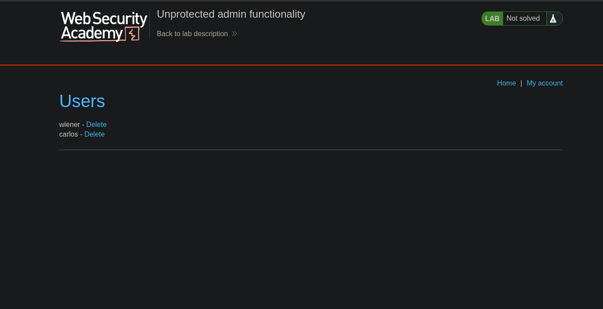

**Category:** Access Control Vulnerabilities  
**Difficulty:** Apprentice  
**Vulnerability:** Vertical Privilege Escalation  
**Platform:** PortSwigger Web Security Academy

## 1. Objective

The objective of this lab is to delete the user `carlos`.

However, we don't have administrator credentials, so we need to find another way to access the admin functionality.

The lab description mentions that the application has an unprotected administrator panel.

## 2. Reconnaissance

First, we investigate the application to find the administrator panel.

One interesting file that we can check is `robots.txt`.

### What is robots.txt?

`robots.txt` is a plain-text file located at the root of a website.

It tells search engine crawlers, such as Googlebot, which paths they are requested not to crawl.

For example:

```
GET /robots.txt HTTP/1.1
Host: vulnerable-website.com
```

When we open `/robots.txt`, we discover the following content:

```
User-agent: *
Disallow: /administrator-panel
```

This indicates that the website asks all compliant crawlers not to crawl `/administrator-panel`.

**Important:** The `robots.txt` file is not a security mechanism. It does not prevent users from accessing the listed paths.

## 3. Exploitation

After discovering the administrator panel path, we navigate directly to:

```
/administrator-panel
```

Surprisingly, the application allows us to access the administrator panel without administrator authentication.

Inside the panel, we find functionality that allows us to delete users.

We select the user `carlos` and delete the account, successfully completing the lab.
### Evidence




## 4. Root Cause

The application does not enforce proper server-side authorization on the administrator panel.

Although the developer included the admin panel path in `robots.txt`, this does not restrict access.

As a result, unauthorized visitors can access administrative functionality.

## 5. Vulnerability Classification

This vulnerability is an example of **Broken Access Control**, specifically unprotected administrative functionality.

It can lead to Vertical Privilege Escalation because a user without administrator privileges can perform actions reserved for administrators.

## 6. Impact

An attacker could potentially:

- Access administrator-only functionality.
    
- Delete user accounts.
    
- Perform unauthorized administrative actions.
    

## 7. Remediation

To prevent this vulnerability, developers should:

- Require authentication for administrative endpoints.
    
- Enforce administrator authorization on the server side.
    
- Deny access by default when permission is missing.
    
- Avoid relying on `robots.txt` or hidden URLs to protect sensitive functionality.
    

## 8. Lessons Learned

From this lab, I learned that:

- `robots.txt` can reveal interesting application paths.
    
- Hidden administrator URLs are not necessarily protected.
    
- Authentication and authorization must be enforced on the backend.
    
- Access control testing should include direct requests to sensitive endpoints.